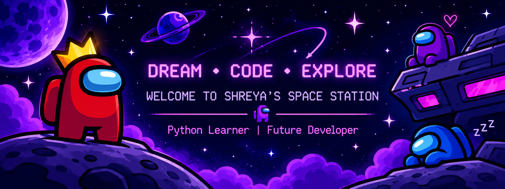

  

🚀 WELCOME TO MY SPACE STATION!

<h1 align="center">👾 HI, I'M SHREYA!</h1><h3 align="center">🚀 Crewmate Developer | Python Learner</h3>

  🌌 Exploring the coding universe, one line at a time!

---

👩‍🚀 ABOUT ME

- 🚀 Hey! I'm Shreya.
- 🐍 Currently learning Python.
- 💻 Practicing programming and GitHub.
- 🌟 Building small projects and improving my skills.
- 👾 My mission: Become a great developer!

🛠️ MY CREWMATE TOOLKIT

  🐍 Python | 💻 VS Code | 🐙 GitHub | 🔧 Git

📂 MY SPACE MISSIONS

- 🟢 Python Codes
- 🔵 Demo Testing GitHub
- 🟣 GitHub Agent

📊 MY GITHUB STATS

"GitHub Stats" 
---

<h2 align="center">📊 MY GITHUB STATS</h2>

  
  

  <a href="https://github.com/shreya1229s">
    🌌 VISIT MY GITHUB PROFILE
  </a>

  🚀 Keep Coding | Keep Exploring | Stay Curious

---
<h2 align="center">🌌 CURRENT MISSION</h2>

  Learning Python and exploring new coding galaxies!

<h3 align="center">
  🚀 THANKS FOR VISITING MY SPACE STATION! 👾
</h3>

