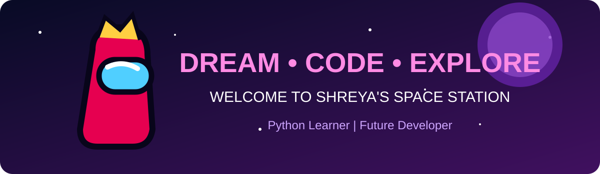

  

🚀 WELCOME TO MY SPACE STATION!

<h1 align="center">👾 HI, I'M SHREYA!</h1><h3 align="center">🚀 Crewmate Developer | Python Learner</h3>

  🌌 Exploring the coding universe, one line at a time!

---

👩‍🚀 ABOUT ME

- 🚀 Hey! I'm Shreya.
- 🐍 Currently learning Python.
- 💻 Practicing programming and GitHub.
- 🌟 Building small projects and improving my skills.
- 👾 My mission: Become a great developer!

🛠️ MY CREWMATE TOOLKIT

  🐍 Python | 💻 VS Code | 🐙 GitHub | 🔧 Git

📂 MY SPACE MISSIONS

- 🟢 Python Codes
- 🔵 Demo Testing GitHub
- 🟣 GitHub Agent

📊 MY GITHUB STATS

"GitHub Stats" (https://github-readme-stats.vercel.app/api?username=shreya1229s&show_icons=true&theme=tokyonight)

🌌 CURRENT MISSION

Learning Python and exploring new coding galaxies!

  🚀 THANKS FOR VISITING MY SPACE STATION! 👾

